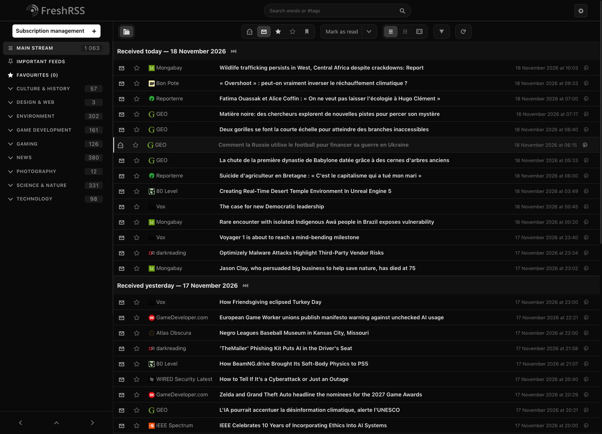

# FreshRSS Mono Dark

A minimal, modern dark theme for [FreshRSS](https://github.com/FreshRSS/FreshRSS): pure black, white and grey, no colour accents.

## Requirements

- FreshRSS with the **User CSS** extension enabled (bundled with FreshRSS: *Settings > Extensions*)
- **Origine** as the base theme (recommended)

The stylesheet overrides most of Origine's styling. Other base themes mostly work but may leave some colors behind.

## Installation

1. Go to **Settings > Display > Theme**, select **Origine** and save. If your version offers a dark-mode option for Origine, leave it off.
2. Go to **Settings > Extensions** and enable **User CSS**.
3. Click the gear icon next to User CSS and paste the contents of [`dark.css`](dark.css).
4. Click **Submit**, then hard-refresh the page.

## License
[MIT](LICENSE)